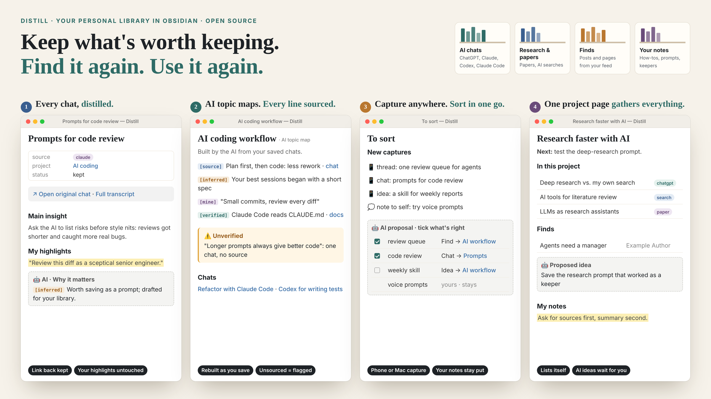

# Distill

Your personal library in [Obsidian](https://obsidian.md): research, papers, finds and AI conversations worth keeping, organised so you and your AI tools can both use it. Claude, ChatGPT/Codex and other AIs work in it under one set of rules: they add freely, and change things only with your OK.

> **New here?** Download the repo (Code → Download ZIP), open the folder in Obsidian with **Open folder as vault**, then open **`Start here`**: five short steps. After that, everything starts from **`Home`**.
>
> **Just want to look around?** Download the filled-in [demo vault](demo/README.md): the same system with about 30 example notes.

This repository is the **system only**: rules, templates, scripts, Bases views, styling and guides, plus a few clearly fictional example notes. It contains no one's real chats or notes.

## The ideas it builds on

- **An LLM-maintained wiki** (after Andrej Karpathy's "LLM wiki" idea): AIs keep summaries and topic maps up to date, so knowledge from chats doesn't stay buried in them.
- **Three layers:** raw sources (chats, transcripts, searches, papers, finds) → an AI layer (`agent/`: wiki, topic maps, questions, outputs) → your own notes (`howto/`, `prompts/`, `ideas/`, `questions/`, `topics/`, `projects/`).
- **Approval before change:** AIs may add freely, but change or delete only with your yes, and never import a chat you didn't approve. See the *Hard limits* table in `AGENTS.md`.
- **Labels on AI lines:** every line an AI writes in the wiki is marked `[source]`, `[inferred]`, `[mine]` or `[verified]`, and links the chat it came from. AI answers are leads, not evidence.

## Quick start

1. Download or clone this repository and open the folder as a vault in Obsidian (**Open folder as vault**). Open `Start here.md`.
2. Install the community plugins listed under *Look and plugins* below. The theme, snippet and plugin settings are already set.
3. Fill in the **Scope** section on `Home.md` and rewrite `system/How I like to work.md` as your own.
4. Point your AI at the vault and say "read CLAUDE.md" (Claude) or "read AGENTS.md" (any other AI).
5. Save your first chat: in a chat, say "save this chat to my vault" (see `system/prompts/Save this chat.md`).
6. Optional version history, kept outside the vault (useful if the vault syncs through iCloud):
   `bash system/scripts/vgit.sh init` (or set `VAULT_GIT_DIR`), then `bash system/scripts/vgit.sh snapshot <tool> "<message>"`.
7. Health check: `python3 system/scripts/check_vault.py` (needs Python 3; PyYAML optional, for property checks).

## What's in each folder

| Folder | What it holds |
| --- | --- |
| `AGENTS.md`, `CLAUDE.md` | The rules every AI follows, and Claude's entry point |
| `Home.md`, `ChatGPT home.md`, `Claude home.md`, `Chats.md`, `Library.md`, `Start here.md` | Dashboards and starting pages |
| `sources/chats/` | Saved chats per app (`chatgpt/`, `claude/`), with `raw/` transcripts, `projects/` and code sessions |
| `sources/searches/` | AI search outputs you saved elsewhere (not chats); originals in `raw/` |
| `sources/papers/` | Research papers and reports, with your highlights and a labelled AI summary |
| `sources/finds/` | Posts and pages from your feed, one note each |
| `agent/` | The AI layer: wiki, topic maps, open questions, outputs, trails, index and log |
| `keepers/` | Your best-of shelf: final findings in any area (best picks, tips, verdicts). Only you change it; AIs only propose |
| `howto/`, `prompts/`, `ideas/`, `questions/`, `topics/`, `projects/` | Your own notes; AIs change them only when you ask |
| `inbox/` | `to sort.md`, where phone captures land until you say "sort my inbox" |
| `system/` | Guides, prompts, templates, fictional template examples, Bases views and scripts |
| `.obsidian/snippets/` | The vault's CSS snippet |

## Look and plugins

The vault ships with its settings, the **Things** theme (MIT, by Colin Eckert, bundled in `.obsidian/themes/`), the `distill` CSS snippet and pre-set plugin settings. Install the plugins once from **Settings → Community plugins → Browse**; their settings are already in place:

- **Notebook Navigator**: Apple Notes–style browsing, with shortcuts to Home, To sort and the chat homes
- **Omnisearch**: typo-tolerant search
- **Quiet Outline**: searchable outline for long notes
- **Hover Editor**: hover a link to read or edit the note in a popup
- **Link Peek**: preview cards for web links
- **Style Settings**: tweak the theme by clicking
- **QuickAdd**: quick capture into To sort
- Optional: **Readwise Official** if you use Readwise Reader

## Scripts (`system/scripts/`)

- `check_vault.py`: read-only health check (broken links, properties, unlabelled AI lines, Bases that won't parse).
- `build_index.py`: rebuilds `system/Index.md` and runs `build_status.py` (`agent/status.md`).
- `build_questions.py`, `build_trails.py`: rebuild *Questions asked* and *Trails to follow* from your saved chats.
- `backup.py`: zips the vault into `agent/backups/` before a big change.
- `vgit.sh`: git with the history kept outside the vault.

## Credits

Built with Claude and ChatGPT. Ideas from Andrej Karpathy (LLM wiki) and Steph Ango (on keeping your own files and notes). Uses Obsidian, Bases and, optionally, the Readwise, Notebook Navigator and Omnisearch plugins.

## License

MIT. See `LICENSE`.
